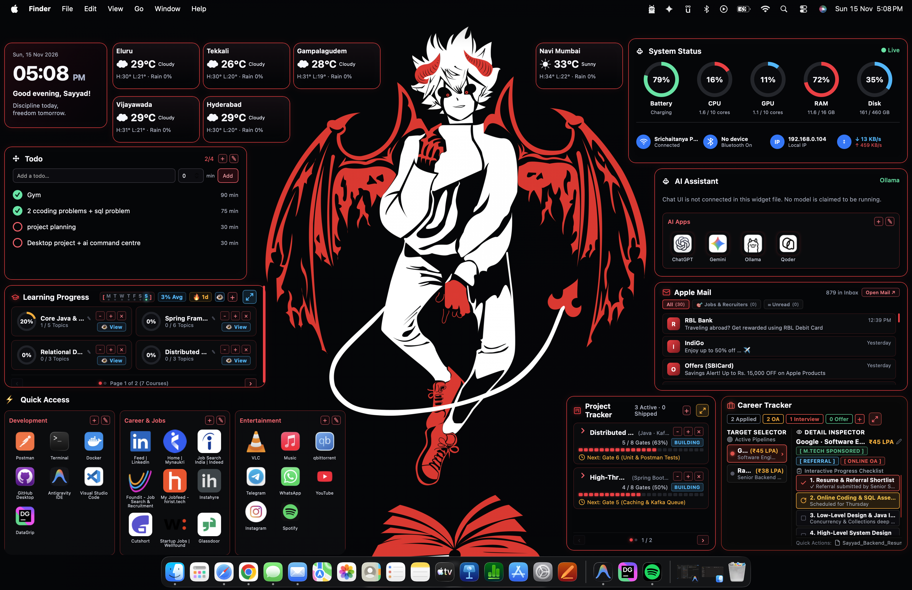
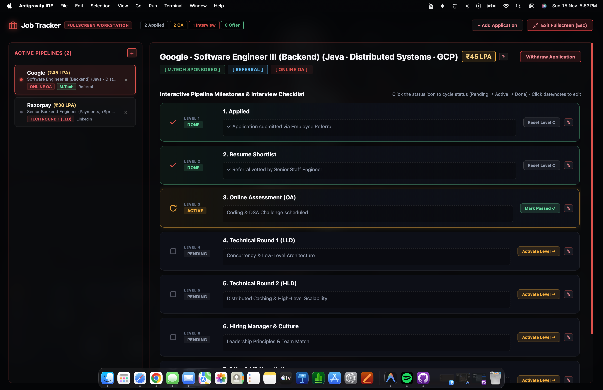
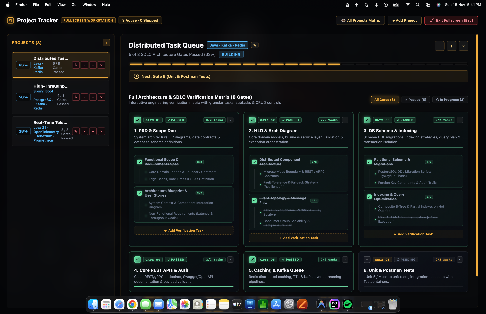
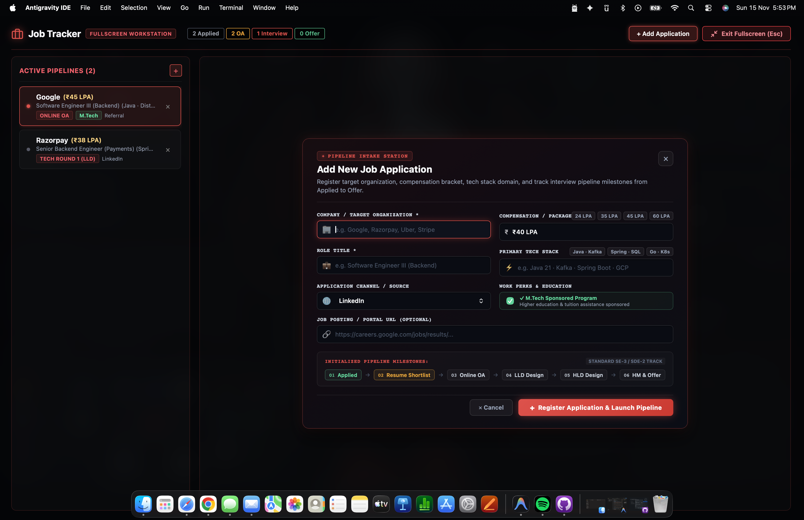
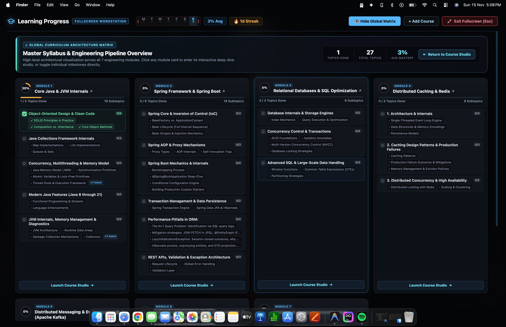
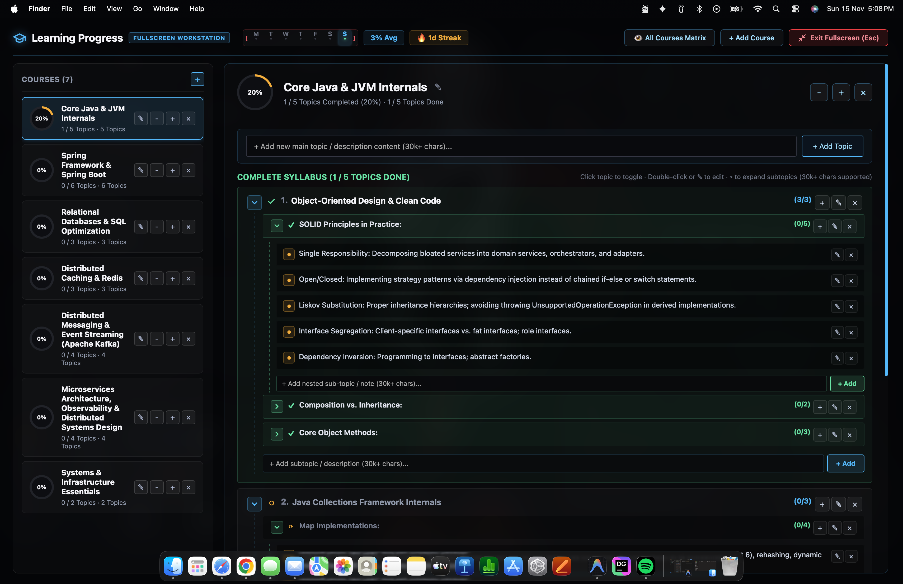
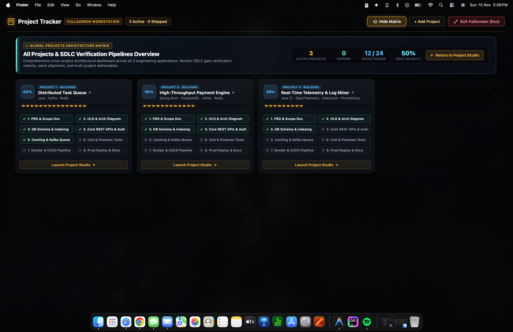
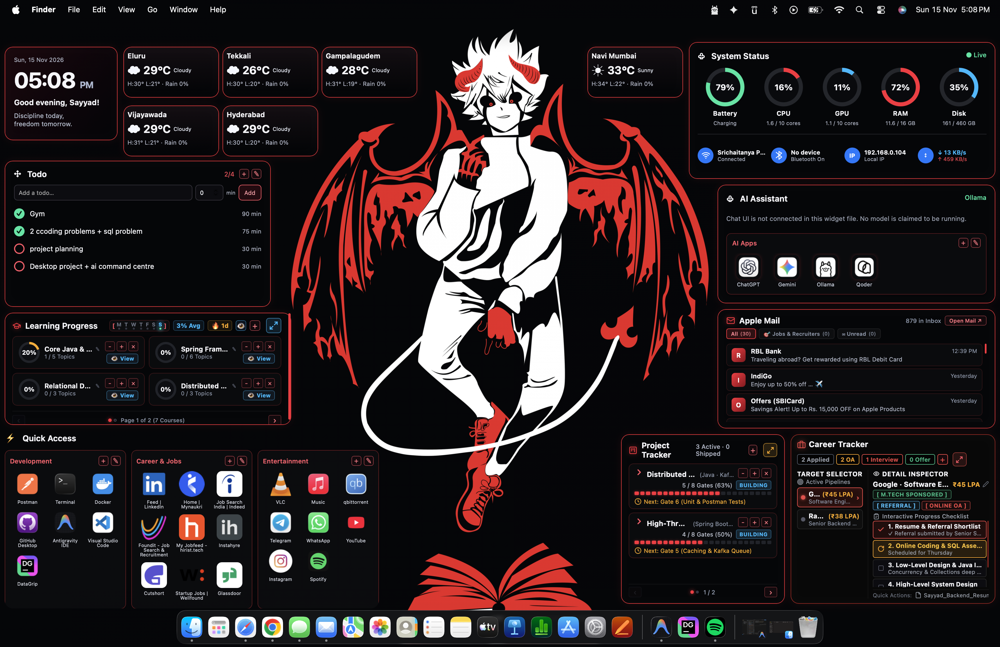

# Cyberpunk Command Center for macOS

A desktop instrumentation environment and developer workstation built for macOS using [Übersicht](https://tracesof.net/uebersicht/). It provides real-time system telemetry, an interactive 7-stage tech job interview pipeline, an 8-gate SDLC project architecture tracker with full task CRUD, and an engineering curriculum matrix.



---

## Real-Time Desktop Showcase

| Normal Desktop HUD | Job Tracker Workstation (Row-Wise Levels) |
| :---: | :---: |
|  |  |

| SDLC Architecture Gate Studio (8 Gates + CRUD) | Job Application Intake Station |
| :---: | :---: |
|  |  |

<details>
<summary><b>Click to view more live desktop screenshots</b></summary>

| Multi-Window Desktop | Workspace Overview |
| :---: | :---: |
|  |  |

| Fullscreen HUD | Detail Inspection |
| :---: | :---: |
|  |  |

</details>

---

## Key Features

### 1. Real-Time System Telemetry & Weather HUD
* **Hardware Gauges**: Live CPU, GPU, RAM, Disk usage, Network Tx/Rx throughput, and Battery health meters.
* **Multi-City Weather**: Temperature, weather conditions, and rain forecast across multiple configured locations.
* **Clock & Focus Todo**: Digital clock, motivational quotes, and quick task management with keyboard accelerators.

### 2. Job Tracker (7-Stage Tech Pipeline)
* **Standardized Pipeline**:
  1. `1. Applied` (Initial milestone marked complete upon application submission)
  2. `2. Resume Shortlist` (Recruiter & referral screening)
  3. `3. Online Assessment (OA)` (Coding & system architecture tests)
  4. `4. Technical Round 1 (LLD)` (Low-Level Design & Concurrency)
  5. `5. Technical Round 2 (HLD)` (High-Level System Design & Distributed Caching)
  6. `6. Hiring Manager & Culture` (Behavioral & engineering leadership)
  7. `7. Offer & HR Negotiation` (Compensation, CTC bands, and team matching)
* **Dual View Modes**: Compact two-column desktop HUD and fullscreen row-wise workstation with status cycling and inline editable notes.

### 3. Project Architecture Tracker (8-Gate SDLC)
* **Architecture Verification Gates**:
  1. PRD & Scope Doc
  2. HLD & Architecture Diagram
  3. Database Schema & Indexing
  4. Core REST APIs & Authentication
  5. Caching & Distributed Messaging
  6. Unit & Postman Tests
  7. Docker Containers & Helm Charts
  8. Production Metrics & Alerting
* **Task & Subtask CRUD**: Add verification tasks, nested subtasks, inline edit names, toggle completion, and delete tasks.
* **All Projects Matrix**: Fullscreen executive multi-project overview comparing architecture health across concurrent projects.

### 4. Learning Curriculum & Global Syllabus Matrix
* **Curriculum Tracking**: Engineering modules across Java Internals, Spring Boot, Databases, Distributed Caching, Kafka, and System Design.
* **Full-Canvas Matrix**: Global architecture overview with mastery rings, milestone progress bars, and individual course studios.

---

## Requirements

* **macOS**: 12.0 (Monterey) or later (Apple Silicon & Intel supported)
* **Übersicht**: [Download free from tracesof.net](https://tracesof.net/uebersicht/)
* **Python 3**: Pre-installed on macOS (`/usr/bin/python3`)

---

## Quick Installation

### Option 1: Automated Shell Script
Clone the repository and run the install script:

```bash
git clone https://github.com/sayyadrahamtulla18/macos-cyberpunk-dashboard.git
cd macos-cyberpunk-dashboard
./install.sh
```

### Option 2: Manual Installation
1. Ensure Übersicht is installed and running.
2. Copy the `cyberpunk-dashboard.widget` folder into your Übersicht widgets directory:
   ```bash
   cp -R cyberpunk-dashboard.widget "$HOME/Library/Application Support/Übersicht/widgets/"
   chmod +x "$HOME/Library/Application Support/Übersicht/widgets/cyberpunk-dashboard.widget/status.py"
   ```
3. Click the Übersicht menu bar icon and select **Refresh All Widgets**.

---

## Fullscreen & Navigation Shortcuts

* **Toggle Fullscreen Mode**: Click the expand icon `[↗]` on any tracker panel (Job Tracker, Project Tracker, or Learning Progress).
* **Exit Fullscreen Mode**: Press `Esc` on your keyboard or click `Exit Fullscreen (Esc)`.
* **Cycle Job Rounds**: Click any round status icon to advance through `Pending` → `Active` → `Done`.
* **Inline Editing**: Click round notes, project tasks, or course topics to edit inline and press `Enter` to save.

---

## Architecture & Design

Detailed architecture diagrams, data flow specifications, and storage schemas are documented in [docs/CYBERPUNK_DASHBOARD_HLD.md](./docs/CYBERPUNK_DASHBOARD_HLD.md).

---

## Contributing

Contributions, feature suggestions, and pull requests are welcome! Feel free to open an issue or submit improvements.
