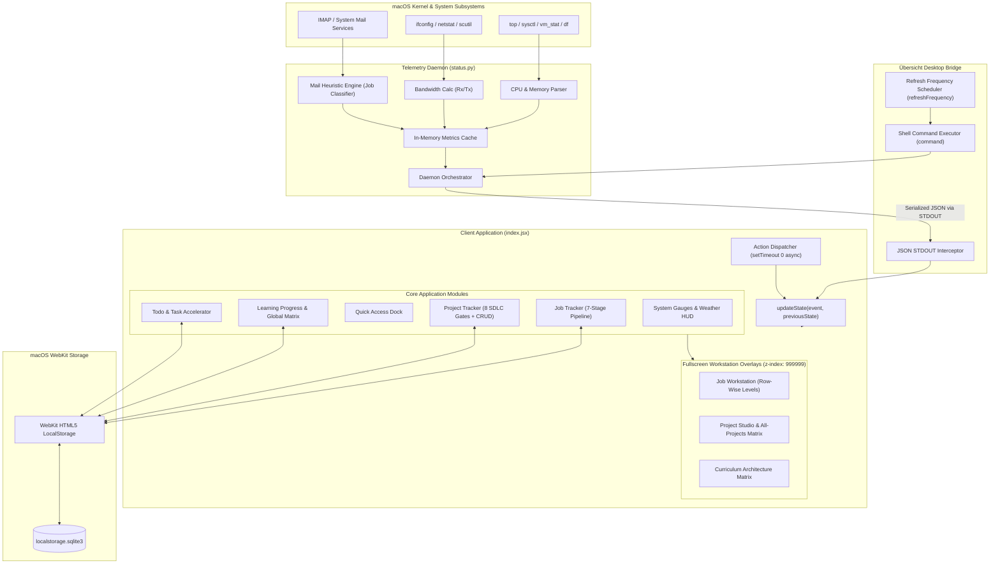
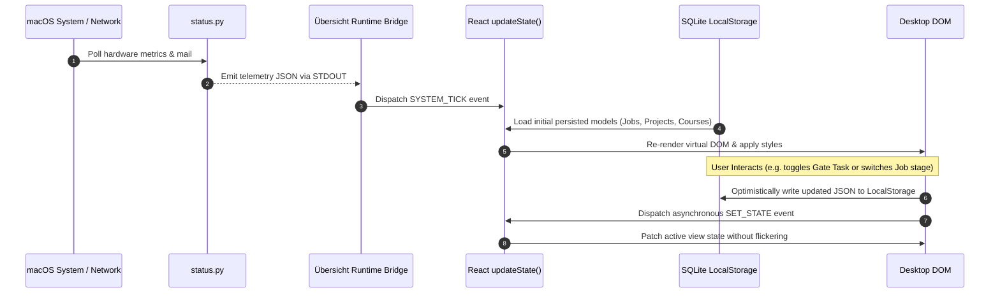

# High-Level Design (HLD): Cyberpunk Command Center Desktop System

---

## 1. Executive Summary & Architecture Overview

The **Cyberpunk Command Center** is a native macOS desktop instrumentation suite and developer workstation operating environment. Built on top of **Übersicht** (a lightweight WebKit runtime embedded directly into the macOS Desktop window server layer), it provides real-time system diagnostics, job pipeline tracking, architecture gate verification, and engineering curriculum tracking.

### Core Architectural Principles
* **Zero-Process Overhead**: Background telemetry is delegated to a lightweight, throttled Python daemon executing strictly when polled by Übersicht's native runtime bridge.
* **Decoupled Reactive Presentation**: React 18 component tree compiled via Babel, implementing a functional unidirectional state reducer pattern with event dispatching.
* **Persistent Edge Storage**: State persistence leverages WebKit's HTML5 LocalStorage engine backed by a native SQLite store (`localstorage.sqlite3`), featuring self-healing schema migration.
* **Hybrid Viewport Architecture**: Seamless switching between an ambient desktop HUD (fixed grid) and fullscreen dedicated workstations (Job Studio, Project Matrix, Global Curriculum Matrix).

---

## 2. System Architecture Diagram

---

## 3. Subsystem Breakdown

### 3.1. Telemetry & Background Daemon (`status.py`)
* **Execution Model**: Invoked periodically by the Übersicht bridge without persistent daemon memory leak risks.
* **Resource Optimization**: Reads directly from `/proc` equivalents via `sysctl`, `vm_stat`, and `ioreg` rather than spawning bloated child processes.
* **Mail Classification Engine**:
  * Ingests unread email headers and subjects.
  * Employs keyword heuristics (e.g., `recruiter`, `interview`, `technical round`, `offer letter`) versus negative transactional signals (`order confirmed`, `swiggy`, `otp`) to categorize emails into `Jobs & Recruiters` vs `General`.
  * Returns formatted JSON payload consumed directly by `updateState()`.

### 3.2. Job Tracker Subsystem
* **Pipeline Standardization**: Standardized 7-stage tech interview lifecycle:
  1. `1. Applied` *(Always marked completed upon application creation)*
  2. `2. Resume Shortlist` *(Referral / recruiter review)*
  3. `3. Online Assessment (OA)` *(Coding, SQL & algorithms)*
  4. `4. Technical Round 1 (LLD)` *(Low-Level Design & Concurrency)*
  5. `5. Technical Round 2 (HLD)` *(System Architecture & Scalability)*
  6. `6. Hiring Manager & Culture` *(Engineering Leadership)*
  7. `7. Offer & HR Negotiation` *(Compensation & Banding)*
* **Visual Paradigms**:
  * **Compact HUD**: Two-column Master-Detail layout with status badges and quick CTC editing.
  * **Fullscreen Workstation**: Left sidebar target selector with row-wise level cards, real-time funnel pills (`Applied`, `OA`, `Interview`, `Offer`), and inline rich-text interview notes.

### 3.3. Project Architecture Tracker Subsystem
* **SDLC 8-Gate Architecture**:
  * `Gate 1`: PRD & Scope Doc
  * `Gate 2`: HLD & Arch Diagram
  * `Gate 3`: DB Schema & Indexing
  * `Gate 4`: Core REST APIs & Auth
  * `Gate 5`: Caching & Kafka Queue
  * `Gate 6`: Unit & Postman Tests
  * `Gate 7`: Docker & Helm Charts
  * `Gate 8`: Prod Metrics & Alerts
* **Hierarchical Verification Task Engine**:
  * Each gate encapsulates discrete verification tasks and nested subtasks.
  * Full inline CRUD capability (`Add Task`, `Add Subtask`, `Edit Name`, `Delete Task`, `Toggle Completion`).
  * Micro-progress bars compute completion percentages both per-gate and across the entire project.
* **All Projects Matrix**: Fullscreen multi-project executive dashboard comparing architecture health across concurrent engineering initiatives.

### 3.4. Learning Progress & Engineering Curriculum
* **Curriculum Engine**: Tracks mastery across 7 distributed systems modules (Java Concurrency, Spring Internals, Relational DBs, Redis Caching, Kafka, System Design, Kubernetes).
* **Workstation Views**:
  * **Course Studio**: Focused topic-by-topic deep dive with inline subtopic authoring.
  * **Global Syllabus Matrix**: Wide-canvas architectural overview displaying all modules simultaneously with progress rings, category tags, and subtopic preview clouds.
* **Activity Streak**: Calculates rolling 7-day commit/study velocity with visual day indicators.

---

## 4. Data Flow & State Lifecycle

---

## 5. Storage Schema & LocalStorage Keys

All client-side data is structured into dedicated namespace keys within WebKit's local storage:

| Storage Key | Data Structure | Purpose |
| :--- | :--- | :--- |
| `cmd_career_inspector_v3` | `Array<CompanyRecord>` | Target companies, CTC, 7 pipeline rounds, notes, sponsorship flags. |
| `cyberpunk-dashboard-projects-v4` | `Array<ProjectRecord>` | Projects, 8 architecture gates, tasks & subtasks, gate statuses. |
| `cyberpunk_learning_courses_v4` | `Array<CourseRecord>` | Modules, units, topics, subtopics, completion flags. |
| `cyberpunk_streak_tracker_v3` | `StreakRecord` | 7-day activity array, current streak counter, last study timestamp. |
| `cmd_tasks_v2` | `Array<TodoRecord>` | Quick-access Todo items, done state, priority flags. |

---

## 6. Performance, Reliability & Security Considerations

### 6.1. Performance & Frame Budget
* **No Heavy React Bundler Overhead**: Babel transforms standard JSX at runtime directly into WebKit native elements.
* **CSS Hardware Acceleration**: Uses CSS transforms (`translateY`, `scale`), CSS variables for dynamic radial rings (`--p`, `--c`), and native `backdrop-filter: blur()`, offloading compositing to the macOS Metal GPU compositor.
* **Async Dispatching**: State updates use `setTimeout(fn, 0)` scheduling to decouple UI touch events from React reconciliation cycles, eliminating interface freeze.

### 6.2. Reliability & Fault Tolerance
* **Non-destructive Migration**: If an existing stored entity uses a previous schema version, the loading routines dynamically upgrade the record in memory and save the migrated structure back to SQLite without data loss.
* **Fallback Defaults**: Every subsystem defines constant initial seed models that auto-populate if the WebKit SQLite storage is uninitialized or corrupted.

### 6.3. Security Boundary
* **Execution Boundary**: Shell command execution is restricted to local system monitoring scripts. No arbitrary remote script evaluation is permitted.
* **Privacy**: Email headers and metrics are processed strictly on localhost inside memory; no telemetry leaves the machine.
